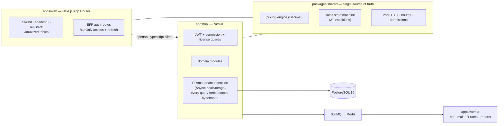

# Cora — multi-tenant ERP-lite for wholesale distributors

> Quote → order → warehouse → shipment in one screen, without the weight of a full ERP.

Cora is a licensable commercial management system I build and sell through my software studio. V1 is complete and running in production for its first customer: product catalog, keyboard-first quote/order editing, ledger-based inventory, shipping and returns, PDF/Excel output, receivables and credit-risk tracking, role administration and an e-document pipeline.

> **The source is private** — Cora is a commercial product. This repository documents the architecture, the engineering decisions and the testing discipline behind it.

**Verification status at V1 sign-off: 48 shared unit tests + 119 API integration tests + a 55/55 Playwright end-to-end suite run against the production deployment.**

---

## Why it exists

The first customer ran daily sales on a legacy desktop ERP: finding a product took a modal-and-field-picker dance, order status was tracked by coloring rows by hand, and nobody could answer "where is my order?" without a phone call. Cora focuses on exactly those pains — instant product search, fast order entry, a visible document flow, profit tracking — while deliberately **coexisting** with the legacy system for accounting (Excel import/export bridges and a migration wizard for products, partners and opening stock).

## Architecture

**Non-negotiable invariants** (from the project's architecture constitution):

1. Every business table carries `tenantId`; a Prisma client extension backed by `AsyncLocalStorage` injects the filter into **every** query, so forgetting it is impossible rather than discouraged.
2. Money is `Decimal(18,4)` end-to-end; using `number` for money is banned. All pricing/discount/VAT/margin math lives in exactly one shared module — the UI previews and the API persists with the **same tested functions**.
3. Stock levels change only through `StockMovement` ledger entries — no direct writes to stock levels. Document numbers come from a sequence guarded by `SELECT … FOR UPDATE`; every document carries a `version` for optimistic locking (concurrent edits → HTTP 409).
4. All sales-document transitions (27 of them), their required permissions and their side effects (reserve / release / deduct stock) are defined in one state-machine file; services cannot write `status` directly.
5. API-first: everything the UI does is available under `/api/v1/...` with OpenAPI docs.

## Engineering decisions worth stealing

- **Tenant isolation enforced in the data layer, then audited.** After the extension was in place, a dedicated hardening pass hunted leakage paths through child tables that carry no tenant column of their own — closed and covered by security tests.
- **RBAC that reaches the serializer.** Cost and profit fields are stripped from API responses at the interceptor layer when the caller lacks `cost.view` — hiding them in the UI is not considered protection. 33 permission codes drive an editable role–permission matrix.
- **Auditability as a default.** Every writing service records a field-level before/after diff to an audit log; soft delete is universal.
- **Licensing built in.** `License { modules[], userLimit, validUntil }` resolves to feature flags; disabled modules disappear from both the menu and the API surface.
- **Evidence-driven delivery.** An architecture constitution, a numbered decision log and per-package closure reports with screenshots document every milestone; each package shipped with its own tests before being declared done.

## Feature surface (V1)

| Area | What you get |
| --- | --- |
| Catalog | Brands, categories, base + package units, trigram search (`pg_trgm` + `unaccent`), faceted filters, photos |
| Quotes & orders | Keyboard-first line editor, multi-currency with FX snapshots, discounts/VAT, document flow quote → order → shipment, partial shipment per line |
| Inventory | Goods receipts, counts, transfers, picking, returns; `onHand / reserved / available`, configurable negative-stock policy |
| Output & import | Pure-JS PDF generation (no Chromium), Excel export with in-cell photos, Excel import wizard |
| Partners & finance | Partner cards with regions/groups, quantity-tiered price lists, running-balance statements, credit-limit risk screen, bulk price updates with preview |
| Administration | Users, editable role–permission matrix, document settings and number prefixes, central-bank FX fetch, audit-log browser with diffs |
| e-Documents | Provider interface + queue for e-invoice / e-despatch, shipping with an honest null provider until an integrator is contracted |
| Hardening | In-app alerts (critical stock, expiring quotes, stuck orders, credit breaches), GDPR/KVKK retention & anonymization tooling, rate limiting, responsive layout |

## Testing discipline

- **Unit** (Vitest): the pricing engine, the state machine and stock logic in `packages/shared` — 48 tests.
- **Integration** (Vitest against a real PostgreSQL): 119 API tests, including tenant-isolation security specs.
- **End-to-end** (Playwright): 55 scenarios covering quote → order → pick → ship → return, run against the **production deployment** before V1 sign-off — 55/55.

## Stack

Next.js (App Router) · NestJS · Prisma (40-model schema) · PostgreSQL 16 · Redis + BullMQ workers · TypeScript strict everywhere · zod validation at both edges · Turborepo/pnpm monorepo · GitHub Actions → GHCR → Docker Compose deploys behind Caddy.

> UI language is Turkish (the product targets the Turkish wholesale market); code, schema and docs are in English, and UI strings live in a dictionary file, so the app is i18n-ready.

## Status

V1 (packages P01–P10) complete and in production. Deliberately deferred: a real e-invoice integrator, automated FX fetching, accounting postings, object storage. Commercial licensing: contact me via [yigittuzcu.com](https://www.yigittuzcu.com).
